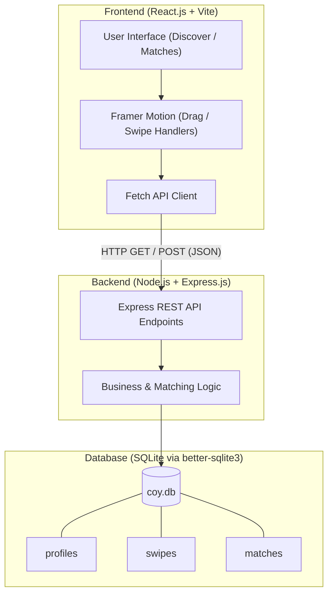
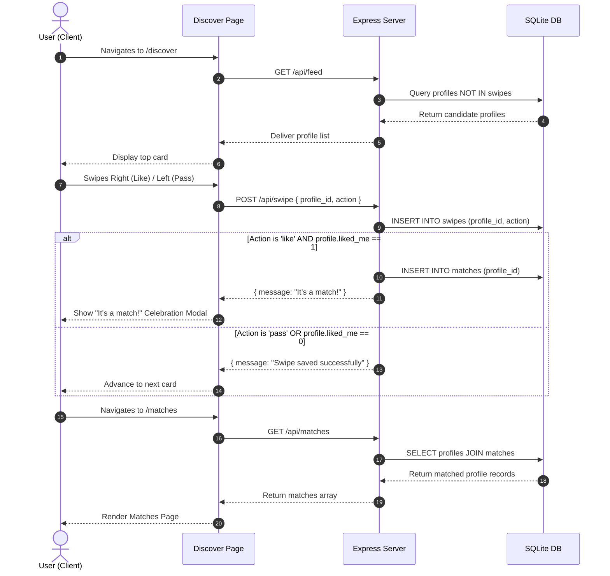
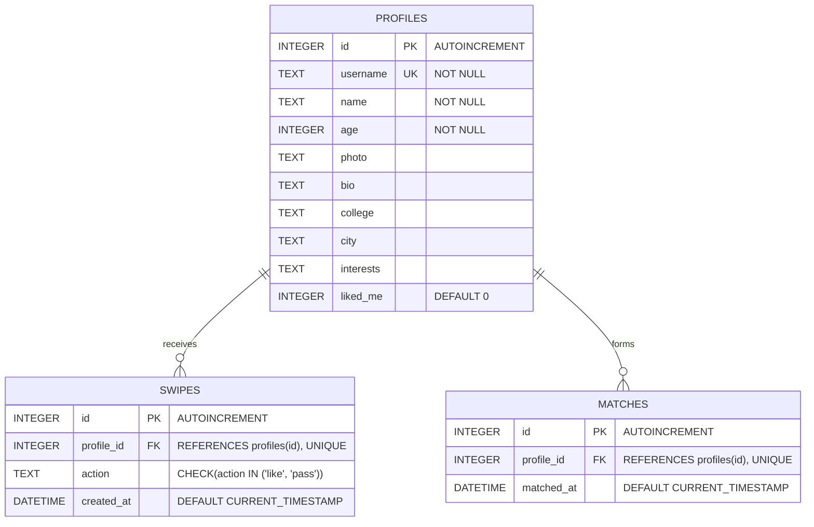

# Coy – Discover | SDE Intern Assignment

<p align="center">
  
  
  
  
  
  
</p>

<p align="center">
  A swipe-based profile discovery and mutual matching application built as part of the <strong>Coy SDE Intern Assignment</strong>.<br />
  The project introduces a standalone <strong>Discover</strong> experience alongside Coy's existing concept, allowing users to explore profiles, express interest through likes, and connect when both users like each other.
</p>

<p align="center">
  <strong>GitHub Repository:</strong> <a href="https://github.com/Mahak-10/coy">https://github.com/Mahak-10/coy</a>
</p>

---

## Table of Contents

- [1. Project Overview](#1-project-overview)
  - [Key Objectives](#key-objectives)
- [2. Features](#2-features)
- [3. Technology Stack](#3-technology-stack)
- [4. Project Structure](#4-project-structure)
- [5. Application Architecture](#5-application-architecture)
- [6. Application Workflow](#6-application-workflow)
- [7. Matching Logic](#7-matching-logic)
- [8. Backend API Documentation](#8-backend-api-documentation)
- [9. Database Design](#9-database-design)
- [10. Getting Started](#10-getting-started)
  - [Prerequisites](#prerequisites)
  - [Step-by-Step Setup](#step-by-step-setup)
- [11. Testing the Application](#11-testing-the-application)
  - [Manual Test Scenarios](#manual-test-scenarios)
  - [Resetting Demo Data](#resetting-demo-data)
- [12. Privacy Considerations](#12-privacy-considerations)
- [13. Future Improvements](#13-future-improvements)
- [14. Author](#14-author)

---

## 1. Project Overview

The **Discover** module provides an intuitive, swipe-based profile discovery experience inspired by industry-standard social applications such as Tinder and Bumble. 

Users can explore candidate profiles one at a time, review personal details, bio, college, city, and interests, and express interest through **Like** or **Pass** actions. 

The application implements a strict **mutual-interest matching mechanism**: a match is created only when both users have liked each other.

The application is engineered as a standalone full-stack project using **React.js**, **Node.js**, **Express.js**, and **SQLite**, built under the single logged-in user assumption as specified in the assignment scope.

### Key Objectives
- **Interactive Interface:** Build an engaging, responsive swipe-based discovery feed.
- **Persistent Interactions:** Reliably record Like and Pass interactions via REST APIs into SQLite.
- **Mutual Matching:** Seamlessly identify when mutual interest exists and notify the user.
- **Deduplication:** Guarantee previously swiped profiles never reappear in the user's feed.
- **Privacy Preservation:** Strictly safeguard privacy by never exposing one-sided incoming likes.
- **Dedicated Matches Space:** Provide a clean Matches dashboard to view all confirmed connections.

---

## 2. Features

### Discover Tab
- **Card-by-Card Presentation:** Displays one candidate profile card at a time with clear focal hierarchy.
- **Comprehensive Profiles:** Presents photograph, name, age, bio, college, city, and interest tags.
- **Realistic Seed Data:** Preloaded with 30 diverse mock profiles for rich demonstration.
- **Responsive Layout:** Optimized for both mobile viewports and desktop browsers.
- **Navigation:** Integrated top navigation bar with Discover, Matches, and placeholder Home tabs.

### Swipe Functionality
- **Dual Interaction Modes:**
  - **Gesture-driven:** Natural drag gestures powered by **Framer Motion** (drag right to Like, drag left to Pass).
  - **Button-driven:** Explicit desktop-friendly action buttons for **Pass** and **Like**.
- **Physics-based Animations:** Smooth spring physics, velocity detection, and card exit transitions.
- **Instant Feed Filtering:** Swiping removes the profile immediately from the feed.
- **Graceful Empty State:** Displays a dedicated banner when all available profiles have been reviewed.

### Mutual Matching
- **Double Opt-In Logic:** A match is established exclusively when both parties have expressed mutual interest.
- **Pre-seeded Incoming Likes:** Configured mock profiles have pre-set likes on the user to facilitate immediate demonstration of match celebrations.
- **"It's a match!" Overlay:** An interactive celebration modal appears the instant mutual interest is confirmed, with options to continue swiping or open a conversation.
- **Privacy by Design:** Incoming likes remain strictly confidential and are never surfaced individually.

### Matches Section
- **Dedicated Matches View:** Easily accessible view rendering all confirmed mutual connections.
- **Match Profile Details:** Displays photo, name, age, college, city, and bio of matched users.
- **Persistent Records:** Matches persist across server restarts and browser reloads.
- **Zero-State Handling:** Contextual empty state displayed when no mutual matches exist yet.

### Data Persistence
- **SQLite Database:** Zero-configuration, server-side relational persistence using `better-sqlite3`.
- **Relational Integrity:** Foreign key constraints linking profiles, swipes, and matches.
- **State Preservation:** Swipe history and matches remain intact across page refreshes.

---

## 3. Technology Stack

| Layer | Technology | Details / Role |
| :--- | :--- | :--- |
| **Frontend Framework** | React.js (v19) | Component-based interactive UI |
| **Build Tool** | Vite (v8) | Ultra-fast HMR and bundling |
| **Styling** | CSS3 | Custom scoped styles, CSS Flexbox & Grid |
| **Animations & Gestures**| Framer Motion (v14)| Physics-based drag-and-swipe gestures & exit transitions |
| **Iconography** | Lucide React | Modern iconography |
| **Client Routing** | React Router DOM (v7)| Client-side declarative routing (`/`, `/discover`, `/matches`) |
| **Backend Runtime** | Node.js | Asynchronous JavaScript runtime environment |
| **API Framework** | Express.js (v5) | RESTful API endpoints and middleware handling |
| **Database** | SQLite3 | Embedded SQL relational database engine |
| **Database Driver** | `better-sqlite3` (v13) | Synchronous, high-performance SQLite driver for Node.js |
| **API Communication** | Fetch API | Native browser HTTP requests |
| **Middleware** | CORS | Cross-Origin Resource Sharing enablement for local dev |

---

## 4. Project Structure

```text
coy/
├── backend/
│   ├── database.js          # SQLite connection and table initialization
│   ├── server.js            # Express REST API endpoints and business logic
│   ├── seed.js              # Database seeder with 30 mock profiles & incoming likes
│   ├── reset.js             # Reset utility for swipes and matches
│   ├── package.json         # Backend dependencies and scripts
│   └── package-lock.json
│
├── frontend/
│   ├── public/              # Static assets
│   ├── src/
│   │   ├── assets/          # Icons and images
│   │   ├── pages/
│   │   │   ├── Discover.jsx # Swipeable profile card feed & match popup
│   │   │   ├── Discover.css # Styles for profile cards, swipe buttons, match modal
│   │   │   ├── Matches.jsx  # Mutual matches directory
│   │   │   ├── Matches.css  # Styles for matches grid and cards
│   │   │   └── Home.jsx     # Placeholder home page
│   │   ├── App.jsx          # Root component & navigation bar
│   │   ├── App.css          # Navigation & global layout styles
│   │   ├── index.css        # Global CSS resets
│   │   └── main.jsx         # React application entry point
│   ├── package.json         # Frontend dependencies and scripts
│   └── vite.config.js       # Vite configuration
│
├── .gitignore
└── README.md
```

---

## 5. Application Architecture

The application adopts a decoupled **Client-Server Architecture** communicating over a RESTful HTTP interface.



- **Frontend:** Responsible for profile presentation, touch/drag gesture handling, spring animations, celebratory popups, and route switching.
- **Backend:** Serves as the central orchestrator, executing unswiped profile feed queries, logging swipe transactions, evaluating mutual match conditions, and delivering match lists.
- **Database (`coy.db`):** Maintains normalized tables for profiles, logged swipes, and confirmed mutual matches.

---

## 6. Application Workflow

The end-to-end lifecycle of an interaction through the platform operates as follows:



---

## 7. Matching Logic

Matching operates on a strict **double opt-in mutual consent model**:

$$\text{Match Status} = \begin{cases} \mathbf{Match}, & \text{if User Action} = \text{Like} \land \text{Target Status} = \text{Liked You} \\ \mathbf{No\ Match}, & \text{otherwise} \end{cases}$$

### Decision Matrix

| Logged-in User Action | Target Profile Incoming Interest (`liked_me`) | Resulting Outcome | Match Record Created? |
| :---: | :---: | :---: | :---: |
| **Like** | `1` (Already liked user) | **It's a Match!** 🎉 | **Yes** (Stored in `matches`) |
| **Like** | `0` (Has not liked user) | Swipe recorded | **No** |
| **Pass** | `1` (Already liked user) | Profile passed | **No** |
| **Pass** | `0` (Has not liked user) | Profile passed | **No** |

> [!IMPORTANT]
> **Privacy Guarantee:** Seeded incoming interest (`liked_me`) is exclusively evaluated within the backend controller. It is **never** leaked to the frontend via `/api/feed`, completely eliminating the possibility of inspecting browser network requests to see who liked the user.

---

## 8. Backend API Documentation

**Base URL:** `http://localhost:5000`

### 1. Retrieve Candidate Feed
Fetches all profiles that the current user has **not** previously swiped on.

- **Method:** `GET`
- **Endpoint:** `/api/feed`
- **Headers:** `Accept: application/json`
- **Success Response (`200 OK`):**
  ```json
  [
    {
      "id": 1,
      "username": "aarav_mehta",
      "name": "Aarav Mehta",
      "age": 21,
      "photo": "https://randomuser.me/api/portraits/men/1.jpg",
      "bio": "Coffee lover and weekend explorer.",
      "college": "Hindu College",
      "city": "Delhi",
      "interests": "Photography, Music, Travel",
      "liked_me": 1
    }
  ]
  ```

---

### 2. Record Swipe Action
Records a `like` or `pass` action on a specific profile. If mutual interest is satisfied, a match is automatically recorded in the database.

- **Method:** `POST`
- **Endpoint:** `/api/swipe`
- **Headers:** `Content-Type: application/json`
- **Request Body:**
  ```json
  {
    "profile_id": 1,
    "action": "like"
  }
  ```
- **Supported `action` values:** `"like"` | `"pass"`

- **Success Responses:**
  - **Mutual Match Created (`200 OK`):**
    ```json
    {
      "message": "It's a match!"
    }
    ```
  - **Swipe Recorded Without Match (`200 OK`):**
    ```json
    {
      "message": "Swipe saved successfully"
    }
    ```

- **Error Responses:**
  - **Invalid Action (`400 Bad Request`):**
    ```json
    {
      "error": "Invalid action"
    }
    ```
  - **Profile Not Found (`404 Not Found`):**
    ```json
    {
      "error": "Profile not found"
    }
    ```

---

### 3. Retrieve All Matches
Fetches full profile information for all users with whom the logged-in user has achieved a mutual match.

- **Method:** `GET`
- **Endpoint:** `/api/matches`
- **Headers:** `Accept: application/json`
- **Success Response (`200 OK`):**
  ```json
  [
    {
      "id": 1,
      "username": "aarav_mehta",
      "name": "Aarav Mehta",
      "age": 21,
      "photo": "https://randomuser.me/api/portraits/men/1.jpg",
      "bio": "Coffee lover and weekend explorer.",
      "college": "Hindu College",
      "city": "Delhi",
      "interests": "Photography, Music, Travel",
      "liked_me": 1
    }
  ]
  ```

---

## 9. Database Design

The relational database is persisted in SQLite (`coy.db`) using three core tables:



### Table Definitions

#### `profiles` Table
Stores candidate discovery profiles.
| Column | Type | Constraints | Description |
| :--- | :--- | :--- | :--- |
| `id` | `INTEGER` | `PRIMARY KEY AUTOINCREMENT` | Unique identifier for the profile |
| `username` | `TEXT` | `UNIQUE NOT NULL` | Unique handle |
| `name` | `TEXT` | `NOT NULL` | User's full name |
| `age` | `INTEGER` | `NOT NULL` | Age in years |
| `photo` | `TEXT` | — | Portrait URL |
| `bio` | `TEXT` | — | Summary / bio string |
| `college` | `TEXT` | — | Affiliated educational institution |
| `city` | `TEXT` | — | Residential city |
| `interests` | `TEXT` | — | Comma-separated list of hobbies |
| `liked_me` | `INTEGER`| `DEFAULT 0` | Flag (`1`/`0`) denoting incoming interest |

#### `swipes` Table
Maintains historical swipe decisions performed by the logged-in user.
| Column | Type | Constraints | Description |
| :--- | :--- | :--- | :--- |
| `id` | `INTEGER` | `PRIMARY KEY AUTOINCREMENT` | Unique swipe identifier |
| `profile_id` | `INTEGER` | `FOREIGN KEY REFERENCES profiles(id), UNIQUE` | Identifier of the target profile |
| `action` | `TEXT` | `NOT NULL CHECK(action IN ('like', 'pass'))` | Performed swipe interaction |
| `created_at` | `DATETIME`| `DEFAULT CURRENT_TIMESTAMP` | Action timestamp |

#### `matches` Table
Maintains confirmed mutual connections.
| Column | Type | Constraints | Description |
| :--- | :--- | :--- | :--- |
| `id` | `INTEGER` | `PRIMARY KEY AUTOINCREMENT` | Unique match identifier |
| `profile_id` | `INTEGER` | `FOREIGN KEY REFERENCES profiles(id), UNIQUE` | Profile ID of the matched user |
| `matched_at` | `DATETIME`| `DEFAULT CURRENT_TIMESTAMP` | Timestamp when mutual match occurred |

---

## 10. Getting Started

Follow these instructions to run the application locally in development mode.

### Prerequisites
Ensure you have the following installed on your machine:
- **Node.js** (v18.0.0 or higher recommended)
- **npm** (v9.0.0 or higher)
- **Git**

---

### Step-by-Step Setup

#### Step 1: Clone the Repository
```bash
git clone https://github.com/Mahak-10/coy.git
cd coy
```

#### Step 2: Install Backend Dependencies
```bash
cd backend
npm install
```

#### Step 3: Initialize Seed Data
Populate the SQLite database with 30 diverse mock profiles and preconfigured incoming likes:
```bash
node seed.js
```
*Output: `30 male profiles inserted successfully!`*

#### Step 4: Start the Backend Server
```bash
node server.js
```
The Express server will launch on:
```text
http://localhost:5000
```

#### Step 5: Install Frontend Dependencies
Open a **new terminal tab or window** and navigate to the `frontend` directory:
```bash
cd frontend
npm install
```

#### Step 6: Start the Frontend Application
```bash
npm run dev
```
Vite will compile and launch the development server at:
```text
http://localhost:5173
```
Open [http://localhost:5173](http://localhost:5173) in your browser to experience Coy Discover.

---

## 11. Testing the Application

### Manual Test Scenarios

The following test scenarios can be used to thoroughly verify application functionality:

| # | Test Scenario | Steps to Execute | Expected Result | Status |
| :-: | :--- | :--- | :--- | :-: |
| **1** | **Initial Feed Load** | Navigate to `/discover` | First unswiped profile card is cleanly rendered with photo, details, and buttons. | Pass |
| **2** | **Desktop Pass Interaction** | Click the **Pass** button | Card animates away; next profile is shown; pass action recorded. | Pass |
| **3** | **Desktop Like Interaction** | Click the **Like** button | Card animates away; next profile is shown; like action recorded. | Pass |
| **4** | **Mobile Gesture Pass** | Drag card $>100\text{px}$ to the left | Card exits left; profile is passed. | Pass |
| **5** | **Mobile Gesture Like** | Drag card $>100\text{px}$ to the right | Card exits right; profile is liked. | Pass |
| **6** | **Mutual Match Trigger** | Swipe right on profile with `liked_me = 1` | Instant **"It's a match!"** modal popup appears. | Pass |
| **7** | **Match Dismissal** | Click "Continue Discovering" on match modal | Modal closes cleanly; user continues swiping through feed. | Pass |
| **8** | **Matches Directory View** | Navigate to `/matches` tab | All confirmed mutual matches are displayed with complete profile cards. | Pass |
| **9** | **Feed Deduplication** | Refresh the browser on `/discover` | Swiped profiles do **not** reappear in the feed. | Pass |
| **10**| **Persistence Verification** | Stop server, restart `server.js`, reload `/matches` | Matches and swipes persist reliably across restarts. | Pass |
| **11**| **Feed Exhaustion** | Swipe through all 30 profiles | Clean empty-state prompt appears: *"No more profiles to discover!"*. | Pass |

---

### Resetting Demo Data

To reset all user swipes and matches to test clean-slate flows:
```bash
cd backend
node reset.js
```
*Output: `Swipes and matches reset successfully!`*

To completely re-seed all 30 profiles from scratch:
```bash
node seed.js
```

---

## 12. Privacy Considerations

Privacy and consent are fundamental to dating and discovery architectures:

1. **Confidentiality of One-Sided Likes:** Incoming likes are never surfaced to the logged-in user unless reciprocal interest is confirmed.
2. **Double Opt-In Integrity:** Both parties must independently express a positive intent before connection details or profiles are shared in the Matches section.
3. **Information Leakage Prevention:** The backend query for `/api/feed` strictly filters candidate profiles without exposing private swipe tables.
4. **Permanent Feed Exclusion:** Swiped profiles are stored in the database and filtered from the feed query to prevent repetitive profile exposure.
5. **Architectural Scope Note:** In accordance with assignment guidelines, this project utilizes a single logged-in user assumption. Full RBAC (Role-Based Access Control), JWT sessions, and encrypted user credentials represent the natural step for multi-tenant deployment.

---

## 13. Future Improvements

Key architectural enhancements planned for a full production deployment:

- [ ] **Multi-User Authentication:** Secure JWT-based auth with OAuth (Google, Apple, Phone OTP).
- [ ] **Dynamic Discovery Filters:** Filter feed by age bracket, geographic radius, college, and shared interests.
- [ ] **Recommendation Algorithm:** Vector embeddings or collaborative filtering to suggest profiles with high matching probability.
- [ ] **Real-Time WebSockets:** Socket.io integration for instant match alerts and in-app chat.
- [ ] **In-App Messaging:** End-to-end encrypted messaging between confirmed mutual matches.
- [ ] **Reporting & Trust/Safety:** User reporting, blocking, automated photo moderation, and rate limiting.
- [ ] **Automated Testing Suite:** End-to-end testing with Playwright / Cypress, frontend unit testing with Vitest, and API integration testing with Supertest.
- [ ] **Cloud Deployment:** Containerization via Docker, backend deployment on Render/AWS, and database migration to PostgreSQL/Supabase.

---

## 14. Author

<div align="left">
  <h3>Mahak Singh</h3>
  <p><strong>B.Tech – Computer Science and Engineering</strong></p>

  <a href="https://github.com/Mahak-10">
    
  </a>
  &nbsp;
  <a href="https://linkedin.com/in/mahak1210/">
    
  </a>
  <br /><br />
  <em>Developed with dedication as part of the <strong>Coy SDE Intern Assignment</strong>.</em>
</div>
